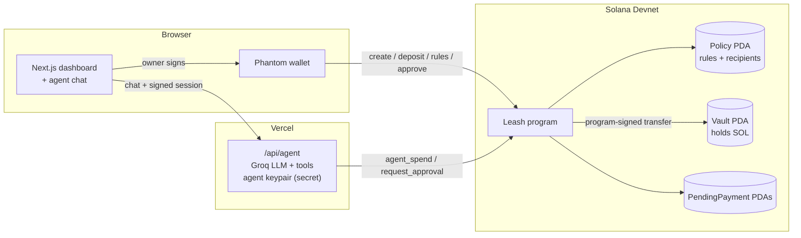

# 🦮 Leash

**Give your AI agent a wallet, on a leash.**

Leash is a Solana vault an AI agent can spend from, but only within rules that are **enforced on-chain** by a Solana program. A confused, prompt-injected or fully hacked agent still can't overspend, pay strangers, or touch your funds.

> Built for the **MLH Solana Hackathon** (Nov 2026) · AI Track

| | |
|---|---|
| | 🌐 **Live app** | [leash-pink.vercel.app](https://leash-pink.vercel.app/) |
| ⛓️ **Program (Devnet)** | [`3FYwa35S5PAQZkqgXHEkTgB414P7j1zXAvwg6fX3YxV5`](https://explorer.solana.com/address/3FYwa35S5PAQZkqgXHEkTgB414P7j1zXAvwg6fX3YxV5?cluster=devnet) |
| 🎥 **Demo video** | *coming soon* |

---

## The problem

AI agents are starting to pay for things: APIs, freelancers, subscriptions. Today you have two bad options:

1. **Give the agent your wallet** and hope the prompt holds. One prompt injection, bug or leaked server and the money is gone.
2. **Approve every transaction yourself**, which defeats the point of an agent.

Limits written in a prompt, or checked by a backend, can be bypassed by whoever controls that prompt or server, including a compromised agent.

## The solution

Leash moves the limits **into a Solana program**. The agent gets its own key, and that key can only ask the program to pay. The program checks the owner's rules on every payment, and Solana's validators enforce the result. Nobody can skip the check, not even us.

```
You (Phantom) ── set rules, deposit, approve ──┐
                                               ▼
AI agent ── "pay Alice 0.1 SOL" ──▶  Leash program (on Solana) ──▶ Vault pays ✅ / rejects ⛔
```

## How a payment is decided

Every time the agent tries to pay, the program runs these checks in order:

| # | Rule | If it fails |
|---|---|---|
| 1 | Agent is not **paused** by the owner | ⛔ `Paused` |
| 2 | Recipient is on the owner's **approved list** | ⛔ `RecipientNotAllowed` |
| 3 | Amount ≤ **max per payment** | ⛔ `ExceedsPerTxLimit` |
| 4 | Amount ≤ **auto-approve threshold** | ✋ Agent must file an approval request; the owner approves or rejects in one click |
| 5 | Today's total stays within the **daily budget** | ⛔ `ExceedsDailyLimit` |
| 6 | Vault has enough SOL | ⛔ `InsufficientFunds` |
| ✅ | All passed | Vault pays the recipient instantly, with no wallet popup |

Blocked attempts are sent on purpose, so they **land on-chain as failed transactions**: public, permanent proof that Solana stopped them.

## Features

- **Vault dashboard:** create a vault, deposit/withdraw, edit rules, manage recipients (name → address), pause switch, live activity feed with Explorer links.
- **AI agent chat:** natural language (*"pay Alice 0.1 SOL for the logo"*, *"how much can I still spend today?"*), powered by Groq with tool calling.
- **Approvals inbox:** payments above your auto-approve limit wait for you, with Approve & pay / Reject.
- **Attack demos:**
  - 🧪 **Prompt injection:** a fake "SYSTEM OVERRIDE" message tries to make the AI send 5 SOL to an attacker.
  - 💀 **Simulated hacked agent:** skips the AI entirely and sends the malicious payment directly. Solana rejects it.
- **Wallet sign-in for the agent:** owners unlock the chat by signing a free message, so only the vault owner can drive their agent.
- **No database:** all state lives on-chain. Vault addresses are derived from the owner's wallet (PDAs).

## Use cases

### One vault, any interface

The rules live on Solana, not in our website, so **any interface** can drive the agent and the limits still hold.

| Interface | Example |
|---|---|
| 💬 **Telegram bot** | Message `@LeashBot`: *"pay Sara 0.2 SOL for the logo"* → paid, with the Explorer link in the reply |
| 🎮 **Discord bot** | A community bot that tips helpful members or pays bounties from a team vault |
| 📱 **WhatsApp / SMS** | Payments by text message for people who never open a crypto app |
| 🎙️ **Voice assistant** | *"Hey assistant, pay the cleaner 0.5 SOL"* |
| 🤖 **Other AI agents** | Coding, shopping or research agents use Leash as their wallet through an API / MCP tool |
| 🌐 **Any website** | An embeddable chat widget, like the one in our dashboard |

Whatever the channel, the owner keeps the same dashboard to set rules, approve big payments and pause the agent.

### Real-world scenarios

- **Freelancers & contractors:** the agent pays approved freelancers when work is delivered; bigger invoices wait for the owner's approval.
- **Pay-per-use APIs & AI services:** an agent buys API calls or compute in tiny amounts, capped by a daily budget.
- **Subscriptions & bills:** recurring payments to known services, made automatically within limits.
- **Family allowance:** a parent's vault lets a teen's assistant spend up to a set amount per day at approved shops.
- **Small business expenses:** an "office agent" orders supplies from approved vendors and asks before large purchases.
- **Teams & DAOs:** a community bot pays bounties and tips from a shared treasury without giving anyone the keys.

> **What's built today:** the web dashboard and the chat agent. Telegram/Discord bots and an agent SDK / MCP server are planned next. They reuse the same `/api/agent` endpoint and on-chain program, so no contract changes are needed.

## Architecture



**Accounts (PDAs)**

| Account | Seeds | Purpose |
|---|---|---|
| `Policy` | `["policy", owner]` | Owner, agent key, limits, today's spending, pause flag, up to 10 named recipients |
| `Vault` | `["vault", policy]` | System account holding the SOL. No private key exists; only the program can sign for it. |
| `PendingPayment` | `["pending", policy, id]` | A payment waiting for owner approval. Closed (and rent refunded) on approve/reject. |

**Instructions:** `initialize`, `deposit`, `withdraw`, `update_policy`, `add_recipient`, `remove_recipient`, `set_paused` (owner) · `agent_spend`, `request_approval` (agent) · `approve_payment`, `reject_payment` (owner)

## Security model

| Actor | Can | Cannot |
|---|---|---|
| **Owner** (Phantom) | Everything: deposit, withdraw, change rules, approve, pause | — |
| **Agent key** | Pay approved recipients within the limits; file approval requests | Withdraw, change rules, pay strangers, exceed limits |
| **Anyone else** | Read everything (it's a public chain); create their *own* vault | Touch someone else's vault |
| **Compromised agent server** | Same as the agent key, nothing more | Break the on-chain rules |

- ⚠️ **Hackathon note:** the program is still **upgradeable** by the deploy wallet so we can ship fixes. Before any mainnet use, it should be made immutable or governed by a multisig with a timelock.

## Repository layout

```
leash/
├── programs/leash/          # Anchor program (Rust)
│   ├── src/
│   │   ├── lib.rs           # instruction list
│   │   ├── state.rs         # Policy, Recipient, PendingPayment, events
│   │   ├── error.rs         # error codes
│   │   └── instructions/    # initialize, funds, admin, agent, approvals
│   └── tests/test_leash.rs  # 9 LiteSVM tests (incl. attack scenarios)
├── web/                     # Next.js app (dashboard + agent API)
│   ├── src/app/api/agent/   # agent endpoint
│   ├── src/lib/server/      # agent signer, tools, LLM, auth (server-only)
│   ├── src/components/      # dashboard UI
│   ├── src/generated/leash/ # typed client generated from the IDL (Codama)
│   └── idl/leash.json       # program IDL
└── Anchor.toml
```

## Run it locally

**Prerequisites:** Rust, Solana CLI and Anchor ([one-line installer](https://solana.com/docs/intro/installation)), Node 20.18+, a Phantom wallet on Devnet, and a free [Groq API key](https://console.groq.com/keys).

**Program (optional: it's already deployed on Devnet)**
```bash
anchor build
anchor test            # runs the LiteSVM test suite
anchor deploy          # deploys to the cluster in Anchor.toml (devnet)
```

**Web app**
```bash
cd web
npm install
cp .env.example .env.local     # then fill in the values below
npm run dev                    # http://localhost:3000
```

| Variable | Description |
|---|---|
| `NEXT_PUBLIC_SOLANA_RPC_URL` / `NEXT_PUBLIC_SOLANA_WS_URL` | Devnet RPC endpoints |
| `NEXT_PUBLIC_AGENT_ADDRESS` | Public address of the agent key (pre-filled when creating a vault) |
| `AGENT_SECRET_KEY` | Agent keypair as a JSON array of 64 numbers (`solana-keygen new -o agent.json`). **Server-only.** Fund it with ~0.05 SOL for fees. |
| `GROQ_API_KEY` | Groq API key. **Server-only.** |
| `GROQ_MODEL` | Comma-separated models tried in order, e.g. `openai/gpt-oss-120b,qwen/qwen3.8-27b` |

After changing the program, regenerate the TypeScript client:
```bash
cp target/idl/leash.json web/idl/ && cd web && npm run codegen
```

## Tech stack

**On-chain:** Solana, Anchor 1.1, Rust, LiteSVM
**Frontend:** Next.js 16, React 19, Tailwind CSS 4, `@solana/kit` 8, Wallet Standard (`@solana/kit-plugin-wallet`), Codama
**Agent:** Groq (OpenAI-compatible tool calling), with model failover and a rule-based fallback
**Hosting:** Vercel · Solana Devnet

## License

MIT
