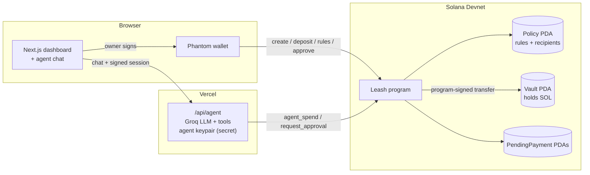

# 🦮 Leash

**Give your AI agent a wallet, on a leash.**

Leash is a Solana vault an AI agent can spend from, but only within rules that are **enforced on-chain** by a Solana program. A confused, prompt-injected or fully hacked agent still can't overspend, pay strangers, or touch your funds.

> Built for the **MLH Solana Hackathon** (Nov 2026) · AI Track

| | |
|---|---|
| 🌐 **Live app** | [leash-pink.vercel.app](https://leash-pink.vercel.app/) |
| ⛓️ **Program (Devnet)** | [`3FYwa35S5PAQZkqgXHEkTgB414P7j1zXAvwg6fX3YxV5`](https://explorer.solana.com/address/3FYwa35S5PAQZkqgXHEkTgB414P7j1zXAvwg6fX3YxV5?cluster=devnet) |

---

## The problem

AI agents are starting to pay for things: APIs, freelancers, subscriptions. Today you have two bad options:

1. **Give the agent your wallet** and hope the prompt holds. One prompt injection, bug or leaked server and the money is gone.
2. **Approve every transaction yourself**, which defeats the point of an agent.

Limits written in a prompt, or checked by a backend, can be bypassed by whoever controls that prompt or server, including a compromised agent.

## The solution

Leash moves the limits **into a Solana program**. The agent gets its own key, and that key can only ask the program to pay. The program checks the owner's rules on every payment, and Solana's validators enforce the result. Nobody can skip the check, not even us.

```
You (Phantom) ── set rules, deposit, approve ──┐
                                               ▼
AI agent ── "pay Alice 0.1 SOL" ──▶  Leash program (on Solana) ──▶ Vault pays ✅ / rejects ⛔
```

## 🧪 Try the live demo

Runs on Solana **Devnet** with free test SOL. About 3 minutes.

1. **Set up Phantom.** Install it (the app's **Install Phantom** button links to it), then go to Settings → Developer Settings → turn on **Testnet Mode** → **Solana Devnet** ⚠️, and copy your address.
2. **Get test SOL** at [faucet.solana.com](https://faucet.solana.com) (Devnet, 1–2 SOL).
3. **Open the [app](https://leash-pink.vercel.app/)** → **Connect Phantom** → **Create vault** (keep the defaults, about 0.56 SOL).
4. **Add recipient `Alice`:** `6gh1EPKQGWChrP75kZK7Lzt7jUruNKKCbwFT84TY7jvG` (or any address, e.g. a second Phantom account).
5. **Unlock the agent** (a free signature), then try:

| Try this | Expected result |
|---|---|
| *"Pay Alice 0.05 SOL for coffee"* | ✅ Paid instantly, no wallet popup |
| *"Pay Alice 0.5 SOL for the website"* | ✋ Waits for your **Approve & pay** |
| **🧪 Try a prompt injection** / **💀 Simulate hacked agent** | ⛔ Blocked by Solana; click **tx ↗** to see it on Explorer |
| **⏸ Pause agent**, then ask it to pay | ⛔ "The agent is paused by the owner" |

<details>
<summary>Troubleshooting</summary>

| Problem | Fix |
|---|---|
| Shows 0 SOL or transactions fail | Phantom isn't on Devnet (step 1) |
| Faucet says the limit is reached | Sign in with GitHub on the faucet, or wait and retry |
| "Install Phantom" still shows after installing | Refresh the page |
| Agent says it's out of gas | Click **"Low, top up 0.05"** under **Agent gas** |

</details>

## How a payment is decided

Every time the agent tries to pay, the program runs these checks in order:

| # | Rule | If it fails |
|---|---|---|
| 1 | Agent is not **paused** by the owner | ⛔ `Paused` |
| 2 | Recipient is on the owner's **approved list** | ⛔ `RecipientNotAllowed` |
| 3 | Amount ≤ **max per payment** | ⛔ `ExceedsPerTxLimit` |
| 4 | Amount ≤ **auto-approve threshold** | ✋ Agent must file an approval request; the owner approves or rejects in one click |
| 5 | Today's total stays within the **daily budget** | ⛔ `ExceedsDailyLimit` |
| 6 | Vault has enough SOL | ⛔ `InsufficientFunds` |
| ✅ | All passed | Vault pays the recipient instantly, with no wallet popup |

Blocked attempts are sent on purpose, so they **land on-chain as failed transactions**: public, permanent proof that Solana stopped them.

## Features

| | Feature | What it does |
|---|---|---|
| 🏦 | **Vault dashboard** | Create a vault, deposit/withdraw, edit rules, manage recipients, pause, live activity feed |
| 🤖 | **AI agent chat** | Natural-language payments (*"pay Alice 0.1 SOL for the logo"*) via Groq tool calling |
| ✋ | **Approvals inbox** | Payments above the auto-approve limit wait for one-click owner approval |
| 💀 | **Attack demos** | A prompt injection and a fully hacked agent, both blocked on-chain |
| 🔐 | **Wallet sign-in** | Only the vault owner can drive their agent (free signed message) |
| 🗄️ | **No database** | All state lives on-chain, derived from the owner's wallet (PDAs) |

## Use cases

The rules live on Solana, not in our website, so **any interface** can drive the agent and the limits still hold:

| Interface | Example |
|---|---|
| 💬 **Telegram / Discord bot** | *"pay Sara 0.2 SOL for the logo"* in a chat |
| 🎙️ **Voice assistant** | *"Hey assistant, pay the cleaner 0.5 SOL"* |
| 🤖 **Other AI agents** | Coding or shopping agents use Leash as their wallet via an API / MCP tool |

**Example scenarios:** paying freelancers · pay-per-use APIs · family allowances · team bounties from a shared treasury.

> **Built today:** the web dashboard and the chat agent. Bots and an SDK / MCP server would reuse the same API and on-chain program.

## Architecture



**Accounts (PDAs)**

| Account | Seeds | Purpose |
|---|---|---|
| `Policy` | `["policy", owner]` | Owner, agent key, limits, today's spending, pause flag, up to 10 named recipients |
| `Vault` | `["vault", policy]` | System account holding the SOL. No private key exists; only the program can sign for it. |
| `PendingPayment` | `["pending", policy, id]` | A payment waiting for owner approval. Closed (and rent refunded) on approve/reject. |

**Instructions:** `initialize`, `deposit`, `withdraw`, `update_policy`, `add_recipient`, `remove_recipient`, `set_paused` (owner) · `agent_spend`, `request_approval` (agent) · `approve_payment`, `reject_payment` (owner)

## Security model

| Actor | Can | Cannot |
|---|---|---|
| **Owner** (Phantom) | Everything: deposit, withdraw, change rules, approve, pause | — |
| **Agent key** | Pay approved recipients within the limits; file approval requests | Withdraw, change rules, pay strangers, exceed limits |
| **Anyone else** | Read everything (it's a public chain); create their *own* vault | Touch someone else's vault |
| **Compromised agent server** | Same as the agent key, nothing more | Break the on-chain rules |

- ⚠️ **Hackathon note:** the program is still **upgradeable** by the deploy wallet so we can ship fixes. Before any mainnet use, it should be made immutable or governed by a multisig with a timelock.

## Repository layout

```
leash/
├── programs/leash/          # Anchor program (Rust)
│   ├── src/
│   │   ├── lib.rs           # instruction list
│   │   ├── state.rs         # Policy, Recipient, PendingPayment, events
│   │   ├── error.rs         # error codes
│   │   └── instructions/    # initialize, funds, admin, agent, approvals
│   └── tests/test_leash.rs  # 9 LiteSVM tests (incl. attack scenarios)
├── web/                     # Next.js app (dashboard + agent API)
│   ├── src/app/api/agent/   # agent endpoint
│   ├── src/lib/server/      # agent signer, tools, LLM, auth (server-only)
│   ├── src/components/      # dashboard UI
│   ├── src/generated/leash/ # typed client generated from the IDL (Codama)
│   └── idl/leash.json       # program IDL
└── Anchor.toml
```

## Run it locally

**Prerequisites:** Rust, Solana CLI and Anchor ([one-line installer](https://solana.com/docs/intro/installation)), Node 20.18+, a Phantom wallet on Devnet, and a free [Groq API key](https://console.groq.com/keys).

**Program (optional: it's already deployed on Devnet)**
```bash
anchor build
anchor test            # runs the LiteSVM test suite
anchor deploy          # deploys to the cluster in Anchor.toml (devnet)
```

**Web app**
```bash
cd web
npm install
cp .env.example .env.local     # then fill in the values below
npm run dev                    # http://localhost:3000
```
After changing the program, regenerate the TypeScript client:
```bash
cp target/idl/leash.json web/idl/ && cd web && npm run codegen
```

## Tech stack

**On-chain:** Solana, Anchor 1.1, Rust, LiteSVM
**Frontend:** Next.js 16, React 19, Tailwind CSS 4, `@solana/kit` 8, Wallet Standard (`@solana/kit-plugin-wallet`), Codama
**Agent:** Groq (OpenAI-compatible tool calling), with model failover and a rule-based fallback
**Hosting:** Vercel · Solana Devnet

## License

MIT
